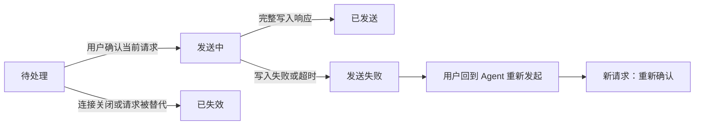

# XIsland 后续优化需求文档

| 项目 | 内容 |
|---|---|
| 文档版本 | 1.0 |
| 编写日期 | 2026-09-15 |
| 状态 | 用户已确认，开始分阶段实施；完成情况见实施计划 |
| 适用范围 | XIsland macOS 客户端、DIBridge、共享协议、VS Code 跳转协作与回归测试 |
| 代码基线 | `f596821becc3dce7e533e93cd49599812a59c15f`；VERSION 为 `1.13.0` |
| 技术约束 | macOS 14+，Swift 5.9+，SwiftUI + AppKit + SwiftData，优先 Apple Silicon |
| 目标读者 | 产品负责人、开发者、测试人员，以及接手实施的代码代理 |

## 1. 文档目的与执行结论

下一轮优化以“能可靠处理 Agent 请求、常驻运行安静、信息容易找到”为目标。主方向采用轻量常驻面板：折叠态提供状态，展开态突出待处理事项，复杂内容通过详情查看。

按四个阶段推进：**建立可复现基线 → 修复交互与数据正确性 → 优化流畅度和界面 → 完善诊断与历史使用体验**。新增便利功能放在上述工作完成之后。

本文规定用户行为、修复范围、验收指标和工作依赖。技术方案是实现约束与建议，不要求为了符合文件划分而进行全项目重构。所有需求均为未来工作，不表示问题已经修复。

### 1.1 基线与证据边界

- 已检查主要视图、状态管理、Socket、持久化、接入配置、UI driver、CI 与仓库截图。
- 2026-09-14 执行 `swift test`：357 个测试，0 失败。该结果仅为当时代码的单元测试基线。
- 没有运行真实 UI smoke，没有进行 Instruments、CPU、内存、能耗或对比度实测。
- 仓库截图用于理解视觉风格，不能证明当前版本的运行效果。
- 已有未跟踪设计 `docs/superpowers/specs/2026-07-16-collapsed-layout-session-count-rotation-design.md` 纳入兼容性参考，保持原文件不变。

### 1.2 优先级与证据分类

| 标记 | 定义 | 执行规则 |
|---|---|---|
| P0 | 已复现的崩溃、不可恢复数据破坏或错误执行审批 | 中断正常排期先处理；本次没有证据足以判定 P0 |
| P1 | 核心交互、数据正确性或回归保障问题 | 首轮交付必须完成 |
| P2 | 性能、可读性、诊断和检索改善 | 分阶段交付；性能改动先测量 |
| P3 | 可选便利功能和产品探索 | 不阻塞本轮主要目标 |
| C | 源码确认的行为或能力缺口 | 实施前补最小复现，不假称已经运行复现 |
| R | 静态风险、尚未实测影响 | 先采样或注入故障确认，再决定改动 |
| N | 新需求或体验选择 | 按用户行为验收，不描述为现有 bug |

## 2. 产品方向、用户与范围

### 2.1 方向比较与本轮选择

| 方向 | 收益 | 代价 | 结论 |
|---|---|---|---|
| 轻量常驻面板 | 日常低打扰，快速发现和处理阻塞 | 复杂内容需要进入详情 | 本轮主方向 |
| 项目控制台 | 多仓库、多子 Agent 的管理能力更强 | 占用空间增大，导航更复杂 | 保留现有项目 Flow，作为展开后的辅助入口 |
| 功能全面扩张 | 可覆盖更多远程、统计和操作场景 | 分散核心修复资源，提高维护成本 | 本轮不采用 |

沿用黑色岛体、浅色主题、现有 Agent 图标与 SF 字体。品牌视觉不重做，SSH、配额、更新、音效等已有功能保持可用。

### 2.2 主要用户场景

| 场景 | 用户目标 | 成功表现 |
|---|---|---|
| 同时运行多个 Agent | 一眼知道谁在运行、谁需要处理 | 待办清晰、不会重复展示、不会跳错会话 |
| 审阅较长计划或命令 | 看清完整内容后做决定 | 可读全文、可附意见、提交对象明确 |
| 连续工作数小时 | 面板不打断工作，不随日志增长变慢 | 空闲刷新少，列表滚动和展开稳定 |
| 外接显示器与 Spaces 切换 | 面板始终可达，正在操作时不突然移动 | 不超屏、不遮挡关键内容、不丢输入焦点 |
| Agent 未出现在面板 | 判断是未接入、暂时无活动还是连接异常 | 配置状态、测试结果、最近事件分别可见 |
| 重启后回看工作 | 找到会话、聊天和工具结果 | 最近记录可恢复，已保存内容不遗漏、不重复 |

### 2.3 本轮包含

1. 权限、问题、计划三类交互的完整阅读、准确路由与提交反馈。
2. UI 测试入口修复、隔离测试环境与性能基线。
3. 空闲刷新、动画策略、多会话派生计算与日志内存管理。
4. 会话列表去重、详情层级、可读性、本地化和键盘体验。
5. 历史增量持久化、失败可见性、异常退出恢复与历史检索。
6. Agent 接入诊断、能力说明与跳转失败反馈。

### 2.4 本轮不包含

- 不重写 SwiftUI/AppKit 架构，不迁移到 Electron，不提高最低 macOS 版本。
- 不新增 Agent 品牌接入，不增加云同步、账号系统、团队协作或移动端。
- 不改变现有 bypass/自动批准策略，不增加新的自动审批范围。
- 不自动重放历史命令、重新执行 Agent 任务或恢复已失效的审批。
- 不新增付费服务依赖；不以更换品牌、音效或大面积装饰动效作为本轮目标。
- 不在本次编写文档时修改 hooks、全局配置、数据库或应用安装。

## 3. 当前问题与修复清单

下表代码位置均相对仓库根目录，行号对应本文代码基线。

| 编号 | 优先级/证据 | 当前行为、影响与修复方向 | 代码入口 | 对应需求 |
|---|---|---|---|---|
| FIX-01 | P1 / C | 内联计划仅 5 行普通文本，反馈固定 nil；补全文阅读和意见提交 | `Views/SessionListView.swift:240`，`Views/PlanReviewView.swift:77` | INT-01 |
| FIX-02 | P1 / C | 内联权限只显示工具和最多 3 行说明，未呈现已收到的路径/diff；补完整详情 | `Views/SessionListView.swift:164`，`Managers/SessionManager.swift:545` | INT-02 |
| FIX-03 | P1 / C+R | 提交后立即清待办并播放成功音，Socket 写入结果被忽略；断开场景可能呈现错误成功反馈 | `Managers/SessionManager.swift:633`，`Managers/SocketServer.swift:187` | INT-03、INT-04 |
| FIX-04 | P1 / C | 主视图渲染内联卡片，UI 场景仍依赖旧面板标识；补真实界面测试 | `Views/NotchContentView.swift:738`，`XIslandUITestDriver/UITestScenarios.swift:130` | QA-01 |
| FIX-05 | P1 / C | 跑马灯、磁吸等未统一遵循 reduceMotion，未查到系统减少动态效果的接入 | `Views/MarqueeText.swift:15`，`Views/NotchContentView.swift:1065` | PERF-01 |
| FIX-06 | P2 / C | 待办与普通列表重复呈现同一会话；卡片内容较密、存在英文硬编码 | `Views/SessionListView.swift:44`、`:185`、`:441` | UI-01、UI-02、UI-03 |
| FIX-07 | P1 / C | 已有会话再次保存只更新标量字段，未同步新增/变更子记录 | `Managers/SessionPersistenceManager.swift:30` | DATA-01 |
| FIX-08 | P1 / C+R | 保存错误被忽略，主要在完成时保存；未完成会话异常退出的记录存在丢失风险 | `Managers/SessionPersistenceManager.swift:50`，`Managers/SessionManager.swift:768` | DATA-02、DATA-03 |
| FIX-09 | P2 / C | 历史页默认取前 100 条，无更多页与详情入口；完善历史查询 | `Managers/SessionPersistenceManager.swift:53`，`Views/PreferencesView.swift:882` | DATA-04 |
| FIX-10 | P2 / C | Hook 活跃状态由配置是否存在决定，不能证明真实事件通路可用 | `Managers/ZeroConfigManager.swift:275`，`Views/PreferencesView.swift:1082` | DIAG-01、DIAG-02 |
| FIX-11 | P2 / R | 60Hz 悬停轮询，短文本也创建动画时间线；空闲 CPU/唤醒影响待测 | `Views/NotchContentView.swift:65`、`:1007`，`Views/MarqueeText.swift:15` | PERF-02 |
| FIX-12 | P2 / R | 列表反复排序，活动日志全量排序后取 30 条，事件不断追加；长会话成本待测 | `Managers/SessionManager.swift:144`、`:828`，`Views/NotchContentView.swift:1182` | PERF-03、PERF-04 |

除 UI driver 外，上表路径前缀为 `Sources/DynamicIsland/`；UI driver 前缀为 `Sources/`。性能风险不以“已证实卡顿”对外描述。

## 4. 核心交互需求

### INT-01 完整计划审查（P1）

- 内联卡片显示摘要及“查看完整计划”；详情提供可滚动的 Markdown、代码块、列表与全文选择复制。
- “批准”“拒绝”“反馈”在详情中可达。反馈可选；非空时原样传递，不得在快捷键路径丢失。
- 草稿与具体会话及当前请求绑定；切换到别的会话不丢草稿，新请求不得继承旧草稿。
- 原有 `PlanReviewView`、`MarkdownView` 能力优先复用或抽取为共享内容，避免维护两套决策逻辑。
- 正在输入、选择文本、查看待办详情或提交时，不触发闲置自动收起，也不自动跨屏移动。

**验收：** 使用 500 行中文/英文混合计划与长代码块，能滚动到末尾；输入多行反馈后通过按钮和 ⌘Y/⌘N 提交，bridge 收到的批准值和反馈一致。切换会话回来草稿保留，新请求到来旧草稿不会被自动提交。

### INT-02 完整权限与问题内容（P1）

- 权限详情展示请求方 Agent、项目、工具、完整说明、文件路径及已有 diff；没有上报的数据显示缺省说明，不编造命令或变更。
- 长命令、路径和 diff 可滚动/选择复制，关键内容不能只在 tooltip 中出现。
- 问题支持现有单选协议，完整显示问题和所有选项；UI 的选项身份使用请求内索引，重复文本仍可独立定位。
- 空问题、无选项的非空问题、请求更新等边界显示明确状态；当前协议无法回答时提供“前往 Agent 处理”，不得用第一项或空字符串替用户决定。
- 自定义文本回答和多选属于 P3，只有接入能力明确支持并完成协议测试后才开放。

**验收：** 2,000 字命令说明、长路径、1,000 行 diff、0/1/3/10 个选项及重复选项均无崩溃、内容不可达或静默选择。

### INT-03 准确的操作对象与队列（P1）

- 每个待办具有本地稳定标识与修订身份，至少区分会话、交互类型、当前请求。不得仅凭列表行号定位请求。
- 卡片显式展示项目与 Agent；多个同名项目需要完整路径提示。收到新待办不抢占用户正在输入或确认的对象。
- ⌘Y/⌘N 作用于明确聚焦的权限/计划，⌘1–⌘3 保持现有问题快捷键能力；不把普通文本框内的按键误解释为另一会话操作。
- 鼠标点击其他待办前先建立该请求的操作上下文；按钮和快捷键共享同一套请求校验与提交逻辑。
- 同一请求在本进程内至多启动一次提交。已处理、过期或被更新替代的控件失效；不同会话继续可操作。
- 一个待办处理后，有其他待办则保持面板打开并选择下一项；全部完成后按用户现有收起配置执行。
- 没有用户焦点时，按权限、问题、计划的类型顺序，再按收到时间由早到晚选择下一项；同一时间使用稳定标识打破平局。有焦点时以用户选择为准。

**验收：** 三个会话同时待办，输入期间插入第四个；键鼠均只处理当前指定对象。双击、键鼠同时提交、提交时请求被替换均不产生重复本地提交，不影响其他会话。

### INT-04 提交结果与失效请求（P1）

交互状态必须区分：`待处理 → 发送中 → 已发送`，以及 `发送失败`、`已失效`。提交成功音只在响应完整写入通道后播放。

- 当前协议没有 Agent 应用层确认。完整写入只表示“已发送”，不能展示“Agent 已执行成功”。后续状态事件继续更新会话。
- 写入失败、断连或超时需回传至界面，不得清除错误信息并伪装正常运行。
- 发送操作不得阻塞主线程，设置有界发送超时；建议本地发送上限 3 秒。
- 当前 bridge 读取响应的超时为 300 秒。保留该兼容行为；检测到连接关闭则立即失效，无法准确得知 Agent 内部期限时显示“可能已失效”，要求回到 Agent 确认。
- 当前代码写入响应后关闭 socket，失败的旧连接不能直接重发。保留用户输入，提供“前往 Agent 重新发起”，新请求到达后由用户重新确认；不得自动重放审批。
- 用户关闭面板只影响显示，不自动批准或拒绝。恢复历史时不恢复响应回调、socket 或审批按钮。

**验收：** 注入断连、部分写入、发送超时和被替代请求；不误报已执行、不播放成功音、不冻结面板、不在新请求上重放旧批准。

## 5. 流畅度与动画需求

### PERF-01 统一动画策略（P1）

优先级为：禁用动画（包括测试配置）> 系统或应用减少动态效果 > 用户动画强度。系统开启或用户开启任一项即进入减少动态效果模式，应用不得覆盖系统偏好。

- 减少动态效果时关闭磁吸位移、果冻缩放、跑马灯平移与装饰性持续运动；状态文字和计数仍然更新。
- 开关在运行时生效。开启后现有动画停止，关闭后只恢复当前可见且必要的动画。
- 与 2026-07-16 设计兼容：折叠计数仍每 5 秒轮换活跃/总计，仅去除淡入淡出、位移和缩放；展开态显示总计。
- 长文本静态显示截断提示，全文可从详情访问；不靠持续滚动作为唯一阅读入口。

**验收：** 系统/应用开关的四种组合、运行中切换、不同动画强度均遵循上述优先级；计数周期测试与动画测试分开。

### PERF-02 无效刷新与窗口调度（P2）

- 文字无需滚动、速度为 0、窗口隐藏或相关视图不可见时，不维护连续动画时间线。
- 鼠标远离岛体时使用事件通知或低频兜底；靠近或拖动时才允许较高频率更新。低频兜底目标不高于 5Hz，具体值由 M0 采样确定。
- 悬停响应、磁吸和跨屏检测分别管理生命周期；隐藏、休眠、显示器断开后及时暂停/释放资源，恢复时不叠加 Timer。
- 不把所有状态都固定限制到低帧率；保留用户正在交互时的正常动画表现。

**验收：** 通过计数器与采样证明短文本及隐藏窗口不再驱动连续时间线；连续隐藏/显示 100 次无重复订阅或计时器增长，指针进入仍满足第 10 节响应目标。

### PERF-03 多会话列表与事件聚合（P2）

- 只在相关数据、筛选条件或排序依据变化时更新派生结果；先定位开销，再选择缓存、局部观察或增量计算。
- 活动总览维持最近 30 条展示语义，避免每次 view body 对全部历史执行完整排序；同时间戳增加稳定次序。
- 流式展示可按约 50ms 合并 UI 刷新，底层事件仍完整接收和存储；审批、错误、完成事件优先处理，不等待文字刷新批次。
- 新增事件只影响相关行；用户键盘聚焦或指针停留期间保持当前卡片的位置与操作对象，结束交互后再按既有排序规则更新。
- 全部会话搜索/分组语义、父子 Agent 关系、镜像会话去重行为不得退化。
- 保持卡片位置只延后普通排序，不隐藏新待办或错误；用户点击刷新/改变筛选条件时允许显式重排，并保留仍存在的焦点身份。

**验收：** 对相同事件集，不同批次划分得到相同最终状态；筛选排序结果与基线一致；高频事件下点击目标不漂移、不丢关键事件。

### PERF-04 日志内存与持久化协作（P2）

- 完整日志持续落盘，内存主要保留近期展示窗口；建议初始窗口每会话 200 条工具事件、200 条聊天消息，属于可调内部参数。
- 正在运行的工具、当前待办、未成功保存的记录不可因数量上限被丢弃；历史详情按需加载。
- 从内存卸载前必须确认相关记录已保存。保存持续失败时停止卸载，展示存储降级；内存超过预算必须报告，不能靠静默丢记录满足指标。
- 导出包含查询范围内的全部已保存记录及尚未落盘记录，并按稳定 ID 去重，不限于内存窗口。

**依赖：** DATA-01/02/03 完成后才允许实施卸载策略。验收包含 60 分钟连续事件、历史加载和导出完整性。

## 6. 界面与可用性需求

### UI-01 信息架构与去重（P2）

展开面板按以下顺序组织：顶部工具栏 → 待处理区 → 会话区 → 可选活动详情。项目 Flow 作为可折叠概览；不在默认状态展开重复的详细会话内容。

- 一个会话存在待办时，在普通列表中不再重复出现；父子结构使用引用或计数提示，不复制完整待办卡片。
- 同一会话同时存在不同类型待办时，使用一个会话容器展示各独立请求；每个请求有自己的修订身份与提交控件，不因为会话去重而隐藏其中任何一项。
- 会话区提供“当前”“已完成”分组，完成项默认折叠；保留现有保留/清理策略。
- 筛选仅约束普通会话列表；待办区明确标注“所有待处理”，不得因搜索条件而把阻塞事项静默隐藏。显示数量分别统计。
- 默认卡片显示标题、项目、文字状态和最近一个动作；工具列表、长回复、来源详情和统计按需展开。
- 同名目录用完整路径区分；总计指当前追踪集合，不是数据库历史累计，待处理计数按有待办的会话去重。

**验收：** 10 个会话中 3 个待办，界面没有重复完整卡片；过滤为另一 Agent 时仍看得见 3 个待办及范围说明。

### UI-02 字号、对比度与操作区域（P2）

- 主内容与关键按钮目标 12–13pt，次要信息目标至少 11pt；岛体极窄布局可用较小计数标签，但不能承载唯一关键信息。
- 常用操作区域目标至少 28×28pt；小图标通过 padding/contentShape 扩大命中范围。此值为本产品目标，不套用手机触控尺寸。
- 普通文本对比度目标至少 4.5:1，状态不能只依赖颜色；暗色与浅色分别测量，允许装饰性非文本另行评估。
- 标题在有限宽度内合理截断，详情和无障碍名称可取得完整值；保留面板宽度/高度设置范围。
- 统一字号、间距、背景、状态色等现有样式常量；仅抽取涉及本轮界面的重复值，不扩大到全局设计系统重写。

**验收：** 默认 380pt 和设置支持的最小/最大尺寸，配合中文、英文长标题截图，确认无裁切操作、重叠或关键文字不可读。

### UI-03 本地化、键盘与无障碍（P1 核心交互，P2 其余）

- 本轮触及的用户可见文案使用 L10n，中、英、日、韩、法保持键一致；修复 Allow/Deny/Approve/Reject 等硬编码。
- 图标按钮有 label/help；状态提供文字和语义标签；Tab 可按视觉顺序访问当前可操作控件，焦点可见。
- 详情中的 Escape 先返回列表且保留草稿；普通列表 Escape 收起。不得将退出阅读解释为拒绝请求。
- 已有搜索、导出和会话切换快捷键保留；输入期间的全局快捷键处理需检查焦点，避免截获文本编辑行为。

**验收：** 三类核心交互仅用键盘可完成；五种语言下无漏键；VoiceOver 可辨认会话、请求类型及按钮动作。

### UI-04 多显示器与现有折叠设计兼容（P2）

- 保留自动跟随鼠标的常态行为；查看待办详情、输入、选择文本、发送期间暂停跨屏迁移，返回列表且无输入/发送操作后恢复。显示器实际断开时仍必须迁移到可用屏幕。
- 显示器断开时迁移到可用屏幕并约束窗口位置，焦点/草稿保留；坐标计算使用 AppKit points，正确处理不同缩放和负坐标屏幕。
- 本轮保留现有物理刘海检测，不新增“自动／刘海／普通”选择器；该选择器属于 2026-07-16 的独立设计。若同期单独合入，必须共享本轮计数/动画策略并通过其模式与旧配置测试，不能把未实施的设计当作现成功能。
- 不以本 PRD 将默认计数替换成“运行数 + 待处理数”。稳定计数样式仅列为 P3 可选模式，旧设置不重置。
- 全屏、Spaces、其他岛体的窗口归属与已有集成行为需回归，不通过持续抢焦点保证可见性。

**验收：** 刘海屏、无刘海外接屏、不同缩放双屏、断开外接屏、切换 Spaces/全屏；操作区可达且草稿不丢失。

## 7. 历史与数据可靠性需求

### DATA-01 子记录正确更新（P1）

- 工具事件、聊天消息持久化稳定 ID，后续保存按 ID 插入或更新；同一工具从运行到完成应更新原记录。
- 再次保存同一会话时，同时保存新增聊天、工具结果、总结和统计；重复保存不能产生重复记录。
- 相同文本、相同工具名或相同时间戳不等于同一记录，不能仅以内容做去重。
- 旧数据无事件 ID 时使用迁移后稳定的标识，不在每次读取时重新生成；不凭相似内容把新事件和旧事件强行合并。

**验收：** 保存 10 条事件 → 更新其中一条结果 → 新增 5 条 → 连续保存 3 次，最终恰有 15 条且修改正确；相同内容的两条独立事件均保留。

### DATA-02 持续保存与失败可见（P1）

- 有脏数据时合并保存，最长间隔目标 5 秒；空闲不写盘。开始、完成、主动关闭会话和正常退出触发保存检查。
- 主线程只产生不可变快照和更新 UI；磁盘工作在受控串行上下文执行，不跨线程传递受上下文绑定的 SwiftData 模型。
- 保存结果明确分为成功/失败；失败保留脏记录与错误摘要，呈现“历史暂未保存”和重试入口。
- 保存连续失败后，后台自动重试间隔为 30 秒，最多一个保存任务在执行；新事件不重置该间隔。用户可手动重试，成功后恢复正常5秒保存策略。正常退出等待保存最多 2 秒，超时提供继续等待或带风险退出的选择。
- 主动关闭正在运行的会话只表示从面板移除/停止追踪，不伪装 Agent 已完成；先保存最后快照。存在待办时禁用会话移除，用户仍可折叠面板或去 Agent 处理。

**验收：** 注入写盘失败后，无成功提示和记录丢弃；存储恢复后重试不重复。20 秒持续事件至少留下可恢复快照，零变化期间无周期空保存。

### DATA-03 重启恢复与迁移（P1）

- 重启可从历史入口访问最近记录和未完成记录。未完成记录标记“中断／状态待确认”，不因读取数据库就加入当前追踪集合，不增加运行数或当前总计；只有收到对应新事件才恢复为当前会话，并关联原有历史。
- 恢复历史内容和本地展示信息，不恢复 socket、回调、过期审批或自动执行动作。
- 数据库增加字段需版本化迁移，优先采用兼容的新增字段；不得删除旧库后重新建库作为迁移方案。
- 迁移前创建可验证的备份，包含 SQLite 相关文件的一致快照；离线迁移或使用存储支持的备份机制，不能只复制正在写入的单个文件。
- 迁移失败保持原数据与备份，显示可恢复错误；禁止继续写入状态不明的库。
- 回退仅在旧应用可读取的存储上进行；不兼容时关闭应用并恢复完整旧备份。回退后新产生的数据不得悄悄覆盖旧备份，需先保留可导出副本。

**验收：** 旧库含空字段、同名事件、大量子记录；升级后的数量/关联/内容一致。正常重启、强制退出后重启、迁移中断都无伪活跃和过期审批按钮。

### DATA-04 历史检索与详情（P2）

- 提供标题、项目完整路径、Agent、日期/状态筛选；搜索先覆盖元数据，聊天全文搜索留作 P3。
- 第一页 50 条，加载更多采用稳定分页顺序；同一时间戳使用稳定 ID 作为第二排序键，翻页不丢项、不重复。
- 详情可查看完整聊天、工具记录、总结与现有统计；长记录分批加载，不一次构建全部视图。
- 导出明确选择“当前会话”“筛选结果”“全部历史”，不受当前已加载页数限制；显示导出数量与失败原因。
- 执行保留期清理后再刷新列表；保留期规则不变，清理不得删除未保存的活跃记录。

**验收：** 5,000 个历史会话中命中 120 个结果，跨页能完整访问和导出；重复时间戳、清理后刷新、零结果、导出失败均有明确表现。

## 8. 接入诊断与错误反馈需求

### DIAG-01 分开显示配置与运行事实（P2）

- Agents 设置页分别显示配置存在性、bridge 可用性、最近收到的真实事件时间和最近测试结果。
- 配置存在文案为“已配置”，不能单独表述为“运行正常”。从未收到事件时显示“尚未收到事件”。
- 无事件不等于断连；CLI 可能本来没有运行。连接异常必须来自测试失败、进程/通道错误等证据。
- 接入检测读取不得在每次 view body 同步扫描全部配置；后台更新结果，测试进行时不重复发起。
- 诊断仅展示必要的错误摘要；不输出完整 Token、提示词、命令正文或隐私路径。复制诊断默认脱敏，用户可预览。

**验收：** “配置存在但 bridge 缺失”“配置正确但从未运行”“近期真实事件”“测试失败”四种场景能清楚区分。

### DIAG-02 自检与能力说明（P2）

- 自检分两级：本地 bridge→socket→解析通路测试；Agent hooks 真实事件检查。前者成功不能声称后者已经验证。
- 自检事件有独立身份，不污染真实会话、历史、统计或音效。
- 每个 Agent 展示状态上报、权限、问题、计划与精准跳转的“支持／有限支持／未知”能力；来自当前适配器与回归证据，不直接照搬 README 的完整支持标签。
- 修复按钮复用现有 hook 配置/修复逻辑，先显示影响的配置文件，保留用户其他内容；失败可重试，不能反复新增重复 hook。

**验收：** 自检后真实列表和历史数量不变；错误落到明确环节；有限能力不出现不可用操作或假成功反馈。

### DIAG-03 跳转结果反馈（P2）

- 保留现有后台跳转和终端/IDE 适配，返回“精准定位”“仅打开应用”“失败”三类可理解结果。
- 缺少应用、窗口已关闭或权限不足时，显示原因与相关恢复操作；可复制工作目录或重新定位。
- 不把仅激活应用表述为成功定位到指定标签页；多次点击不会无限堆积后台跳转任务。

**验收：** 标签存在、只找到应用、应用未安装和定位失败四种测试结果与用户提示一致。

## 9. 技术边界与兼容性

### 9.1 模块职责

| 范围 | 职责 | 本轮边界 |
|---|---|---|
| DIShared / DIBridge | 编解码、帧边界、请求响应 | 保持既有 JSON rawValue 与单选字符串语义；新增字段必须可选 |
| SocketServer | 接入、读取/写入、结果报告、连接释放 | 阻塞 IO 不占主线程；发送失败向业务层返回，不要求外部 Agent 升级 |
| SessionManager | 会话状态、交互身份、排序/过滤、变更快照 | 核心状态在 MainActor；保留查找索引、镜像去重与子 Agent 规则 |
| SwiftUI / NotchWindow | 呈现、焦点、尺寸、输入与动画 | 使用同一交互提交入口；不在视图复制协议处理逻辑 |
| Persistence | 增量保存、分页、恢复与迁移 | 串行存储工作；后台数据回主线程使用值类型快照 |
| Diagnostics / Tests | 自检结果、fixture、故障注入和基线 | 测试身份、路径与用户环境隔离 |

### 9.2 必须保留的兼容性

- 旧版 bridge/新客户端、新版 bridge/旧客户端的既有消息仍可解析；兼容测试覆盖可选字段缺失。
- 不把本地“至多提交一次”扩展宣称为跨进程 exactly-once；无 Agent ACK 时不保证对方执行。
- 旧版 UserDefaults、主题、窗口位置、面板尺寸、音效与静音规则保留。未知新增设置回落到文档指定默认值。
- 既有折叠布局设计为兼容要求，固定计数提案不覆盖该设计。新的冲突决策需在变更记录中明确替代哪条要求。
- 持久化格式升级必须先完成迁移/回退验证；启用内存日志卸载依赖可靠保存，不能先裁剪数据再补存储。

## 10. 非功能目标与性能验收口径

本节数值为**建议验收目标，不是已测结果**。M0 使用真实基线校准；如需调整，先修订本节并记录测量依据，再作为后续发布门槛，不得在失败后直接降低标准。

### 10.1 测量方法

- 主验收机器：用户的 Apple Silicon M3 Max；记录 macOS、内存、显示器缩放/刷新率、构建 hash、电源模式和温度状态。
- 使用 Release 构建与隔离的模拟会话；性能场景开启正常动画，禁止沿用自动 disableAnimations/reduceMotion 的 UI smoke 配置。
- 每个场景预热 30 秒，采样至少 120 秒；独立运行 3 次，记录各次数据、汇总中位数与最差值。
- CPU 百分比按“100% 为占满一个逻辑核心”，不按全机核心数平均稀释；基线和改动后使用同一工具/参数。
- 使用 Instruments 的 SwiftUI、Time Profiler、Animation Hitches/对应系统版本工具，必要时增加本地 signpost。不同工具版本不支持的字段不可填 0，需标注不适用并提供等效测量。

### 10.2 场景与目标

| 编号 | 场景 | 目标与口径 |
|---|---|---|
| MET-01 | 空会话或全部静止、鼠标远离、无必要动画 | 120 秒平均 CPU ≤1%；无持续视图动画时间线；若原基线已≤1%，新值不增加超过 0.2 个百分点 |
| MET-02 | 10 个会话、每秒共 20 个状态/文字事件，单事件正文≤2KiB | 已解码关键事件进入主业务队列到首个相关可见状态更新 p95≤100ms；无遗漏审批/完成/错误 |
| MET-03 | 面板开合与正常列表滚动 | 输入到首次可见反馈 p95≤100ms；默认强度展开稳定≤450ms；采样中无应用原因导致的≥100ms 主线程停顿 |
| MET-04 | 10 会话连续滚动/动画 | 卡顿时长占比=工具报告的累计卡顿时长/采样总时长，3次采样取中位数；基线占比≥1%时相对降低≥30%，低于1%时增加不超过0.1个百分点 |
| MET-05 | 50 个会话、每会话初始 1,000 条工具事件+1,000 条消息，持续每秒共 50 条、每条正文≤2KiB，60分钟 | 无崩溃、未处理事件不丢失；第10至60分钟驻留内存增量≤50MiB，末10分钟按每秒采样计算的线性增长斜率≤0.5MiB/分钟，完整记录由存储承载 |
| MET-06 | 5,000 条会话元数据、缓存冷启动与暖缓存分别测 | 历史第一页 p95≤300ms；元数据筛选首屏 p95≤500ms；输入不阻塞主界面 |
| MET-07 | 正常可写磁盘持续事件 | 最近成功快照距当前数据不超过5秒；存储故障明确标为降级，不能以丢弃数据满足该指标 |

MET-02 的起点不包含外部 Agent 网络耗时；终点必须是相关状态的呈现测点，不只是函数返回。MET-05 分别报告驻留内存、待保存队列和数据库大小；若记录正文超出该负载上限，另外做大消息边界测试，不与固定预算混用。

## 11. 回归测试要求

### QA-01 真实界面标识与断言（P1）

- 当前内联待办与详情设置稳定 accessibility identifier，包含会话和请求身份；不要用本地化文案或数组位置定位跨会话按钮。
- UI driver 操作当前真实控件，断言目标会话、请求、提交结果、剩余待办和面板状态，而非只检查窗口存在。
- 单元测试验证场景定义不能替代实际 app UI 运行。旧未使用面板的测试需要迁移到真实入口或明确保留用途。

### QA-02 环境隔离（P1）

- 测试独立配置根目录、UserDefaults 域、SwiftData 存储、socket、日志、bridge 安装目录和 fixture 身份；路径需可显式注入并由进程回报核验。
- 不依赖单独改 HOME 推断所有路径已经隔离；现有 DISocketConfig 从 FileManager 获取 home，必须验证客户端与 bridge 实际解析到同一测试地址。
- 不用泛化 `pkill XIsland`，只结束测试创建并核验身份的 PID；只清理测试运行目录，不触碰真实 socket 或 hooks。
- 测试结束前后比较真实配置/关键路径状态，变化视为测试失败；测试进程崩溃后也能清理隔离资源。
- 当前 `test-all.sh`/`test.sh` 会操作真实应用和 socket，不作为无人值守默认命令直接复用；应在完成上述改造后再加入自动门禁。

### QA-03 验收矩阵（P1/P2 按对应需求）

| 用例 | 操作与数据 | 必须证明 | 层级 |
|---|---|---|---|
| CASE-01 | 长计划+多行反馈，按钮与键盘批准/拒绝 | 全文可达、反馈一致、对象正确 | 单元+协议+UI |
| CASE-02 | 长命令、路径、diff、缺少可选字段 | 不遗漏已上报信息，无编造内容 | UI+截图 |
| CASE-03 | 0/1/3/10选项、重复文本、流式替换请求 | 无崩溃、无静默默认回答、旧控件失效 | 单元+UI |
| CASE-04 | 3个待办+插入新请求+双击/键鼠并发 | 本地至多一次提交、草稿及焦点不串会话 | 单元+协议+UI |
| CASE-05 | 断连、部分写入、写入超时、请求过期 | 已发送与失败区分，无主线程阻塞 | 故障注入+UI |
| CASE-06 | 系统/应用减少动态效果开关四组合 | 无装饰位移，必要计数仍轮换 | 单元+真实动画观察 |
| CASE-07 | 短/长文本、隐藏/显示100次、休眠恢复 | 生命周期正确，空闲时间线停止 | 单元+采样 |
| CASE-08 | 10/50会话、长日志、高频事件 | 排序与最终数据一致、目标稳定、满足性能指标 | 负载+采样 |
| CASE-09 | 深浅主题、五语言、最小/默认/最大尺寸 | 无关键控件裁切，标签、焦点、对比度达标 | UI+截图+人工 |
| CASE-10 | 双屏缩放、负坐标、拔屏、Spaces/全屏 | 面板可达、输入期间不迁移、状态不丢 | 实机 |
| CASE-11 | 保存→更新事件→追加→重复保存 | 稳定ID更新、无遗漏或重复 | SwiftData集成 |
| CASE-12 | 磁盘失败/恢复、正常退出/强制退出 | 错误可见、成功快照可恢复、无过期审批 | 故障注入 |
| CASE-13 | 旧库升级、迁移中断、恢复备份 | 关联与内容完整，回退真实可用 | 迁移集成 |
| CASE-14 | 5,000历史、120命中、跨页/导出/清理 | 筛选完整，导出不局限已加载页 | 集成+UI |
| CASE-15 | 配置/bridge/真实事件/自检各状态 | 不把配置存在等同接入正常，测试不污染数据 | 单元+集成+UI |
| CASE-16 | 跳转到标签/仅应用/未安装/失败 | 反馈与实际定位能力一致 | 注入+实机抽查 |
| CASE-17 | 旧/新bridge客户端组合、镜像会话及子Agent | 既有消息、去重、关系与快捷键不退化 | 协议+回归 |
| CASE-18 | 测试成功、失败、异常退出 | 真实配置及socket不变，只清理测试资源 | 环境隔离验证 |

### QA-04 发布门禁与验证入口（P1）

- 每个行为修复先加入能覆盖原问题的有效测试，再验证修复后通过；不只断言函数或控件名字。
- 每次 PR 运行 `swift build`、`swift test`；修改 CLI 时运行 `bash Scripts/test-cli.sh`。文档独立修改只做链接/结构检查。
- 涉及视图、状态路由或协议时，运行隔离后的核心 UI/集成场景。托管 CI 无图形桌面或辅助功能权限时，使用有权限的本地/专用 macOS runner 保存证据，不把未运行标为通过。
- 动画修改必须附真实动画采样，数据格式修改必须附迁移与回退结果。常规 UI smoke 禁用动画仅用于确定性检查。
- 测试产物包含构建 hash、场景、环境、断言、日志/截图/采样文件位置；异常诊断默认脱敏。

## 12. 实施阶段与任务包

工作量 S/M/L 表示相对复杂度，不是承诺工期。未确认开发人数和可用时间，因此以阶段出口安排顺序，不预设发布日期或产品版本号。

| 阶段 | 工作包 | 优先级 | 复杂度 | 依赖 | 交付与出口 |
|---|---|---|---|---|---|
| M0 基线 | QA-02 测试隔离，建立现状UI结果及MET基线 | P1 | M | 无 | 隔离验证通过；记录已知失败；性能口径可重复 |
| R1-A 核心交互 | INT-01/02、核心UI-03、QA-01 | P1 | M | M0 | 全文/反馈/内容边界可用；新入口能由UI驱动操作 |
| R1-B 提交可靠性 | INT-03/04 | P1 | L | R1-A | 多请求键鼠一致；断连失败反馈正确；不误报执行成功 |
| R1-C 数据正确性 | DATA-01/02/03 | P1 | L | M0 | 增量保存、错误可见、恢复及迁移通过；可与R1-A并行 |
| R1-D 动画可访问性 | PERF-01、UI-03核心回归 | P1 | M | M0 | 系统/应用策略统一，符合计数轮换兼容要求 |
| R2-A 空闲与高负载 | PERF-02/03/04 | P2 | L | M0采样；卸载另依赖R1-C | 性能目标达成；完整日志与导出不损失 |
| R2-B 界面体验 | UI-01/02/03/04 | P2 | M | R1-A/B/D | 去重、详情、可读性、跨屏通过；与R2-A协调共享视图 |
| R3-A 可诊断接入 | DIAG-01/02/03 | P2 | M | M0；DIAG-03复用R1-B错误呈现 | 配置与通路状态清楚，自检不污染，跳转失败可理解 |
| R3-B 历史使用 | DATA-04 | P2 | M | R1-C | 搜索、分页、详情、导出可用 |
| 各阶段收尾 | QA-03/04、README/截图/变更说明 | 同阶段 | S–M | 相应任务 | 证据完整，无未解释回归，待用户确认后发布 |

### 12.1 第一轮完成定义

R1 完成必须同时满足：三类核心交互可用，提交失败不会伪成功，真实 UI 场景通过，子记录更新正确，存储失败可见，重启恢复和迁移验证通过，减少动态效果一致。不得因 UI 美化或性能数字改善而跳过这些要求。

### 12.2 全轮完成定义

所有 P1/P2 需求均有对应验收证据；第 10 节性能目标通过或经文档修订明确调整；旧配置/协议/数据兼容通过；更新截图及 README 的实际支持说明；无 P0/P1 未解决项。实现中发现的新问题登记证据和优先级，不无限扩展当前迭代。

## 13. 可选后续需求（P3）

| 编号 | 方向 | 启动条件 | 边界 |
|---|---|---|---|
| NEXT-01 | 固定会话与稍后处理 | 多会话用户确认频繁需要 | 稍后不等于回答，不延长Agent真实超时；阻塞数仍可见 |
| NEXT-02 | 按项目保存筛选 | DATA-04/UI-01稳定 | 不增加第二套项目身份；使用标准化完整路径 |
| NEXT-03 | 自定义回答、多选 | 适配器确认能力并有协议样例 | 不对所有Agent统一假定支持 |
| NEXT-04 | 稳定折叠计数模式 | 用户选择新的可选样式 | 不改变既有5秒轮换默认与旧设置 |
| NEXT-05 | 聊天全文搜索 | 历史使用频率与数据规模支持投入 | 先评估索引、存储和隐私成本 |

## 14. 风险、回退与发布要求

| 风险 | 控制办法 | 回退方式 |
|---|---|---|
| UI改版遗漏旧能力 | 按三类交互的能力清单验收，复用现有内容组件 | 回退界面改动，保留已验证的核心提交逻辑 |
| 输入焦点和自动隐藏互相影响 | 待办/输入/提交保护状态共用，测试插入新事件 | 回退新增自动隐藏策略，保留用户显式收起 |
| 缓存产生陈旧列表 | 用同一事件序列对比最终排序/筛选结果 | 关闭缓存，保留正确性路径与采样证据 |
| 日志卸载导致内容丢失 | 保存确认后才卸载，保存失败时降级 | 禁用卸载；不修改已保存完整记录 |
| SwiftData迁移失败 | 一致备份、旧库fixture、故障注入 | 按DATA-03恢复完整旧备份，保留升级后数据副本 |
| 新旧bridge不兼容 | 可选字段、组合测试、不依赖外部ACK | 保留旧消息格式和已验证bridge版本 |
| 性能测试被禁用动画掩盖 | 独立性能配置，产物记录动画开关 | 重测，不接受无效采样作为通过 |
| 本地测试污染日常环境 | 显式路径/域注入、PID核验、前后比较 | 只清理测试资源，原配置备份可恢复 |

数据库迁移实施前单独展示影响范围和回退操作；真实用户存储的写入与迁移需明确确认。按功能包逐步交付，避免把全部 UI、协议和数据库改动捆在一个无法独立回退的提交里。

## 15. 实施交付文件与文档维护

每个工作包交付：对应最小源码变更、有效测试/fixture、验证记录、用户可见变更说明。数据相关另附迁移方案与恢复步骤；性能相关另附可重复负载定义、基线和对比采样。

- 代码继续放入现有 `Sources/` 和 `Tests/` 结构；按真实职责拆分涉及的长文件，不为行数创建空壳层。
- 在 `docs/superpowers/plans/` 按工作包记录具体实施步骤；本文保持需求与验收的权威入口。
- 测试与性能日志存放忽略的产物目录，报告引用其位置；不得把用户真实消息和路径原文提交进仓库。
- README 的测试数、截图、快捷键、审批能力和 Agent 支持等级以实际交付为准，避免文档继续描述旧入口。
- 仓库目前缺少项目级 AGENTS.md。建议补充技术栈、构建/测试命令、主线程边界、测试隔离、hooks副作用、L10n和提交确认规则；该文件不是本需求文档的隐含改动。

## 16. 参考与变更记录

- 前置评审：2026-09-14《XIsland 优化评审》，Obsidian 项目总结。
- 仓库设计：`docs/superpowers/specs/2026-04-15-automated-regression-testing-design.md`。
- 布局兼容设计：`docs/superpowers/specs/2026-07-16-collapsed-layout-session-count-rotation-design.md`。
- 性能测量参考：[Apple — Improving app responsiveness](https://developer.apple.com/documentation/xcode/improving-app-responsiveness)、[Apple — Optimize SwiftUI performance with Instruments](https://developer.apple.com/videos/play/wwdc2025/306/)。本文具体性能预算为项目建议值，不是 Apple 对此应用的测量结论。
- 可访问性参考：[Apple Human Interface Guidelines — Accessibility](https://developer.apple.com/design/human-interface-guidelines/accessibility)。本文字号和命中区域为本产品验收目标。

| 日期 | 版本 | 变更 |
|---|---|---|
| 2026-09-15 | 1.0 | 将源码评审整理为完整需求；定义12项问题、23项主体需求、性能目标、18项验收场景和分阶段实施顺序；明确兼容既有折叠轮换设计 |
